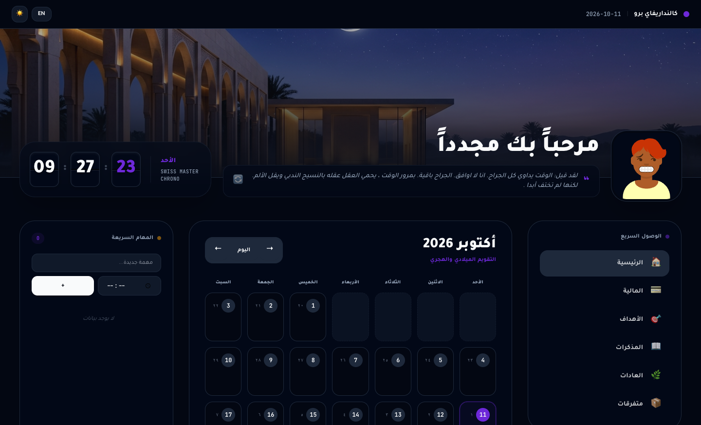
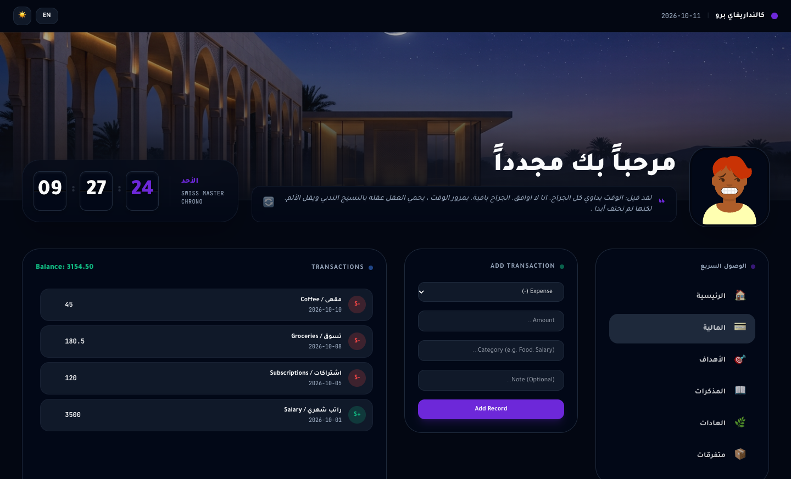
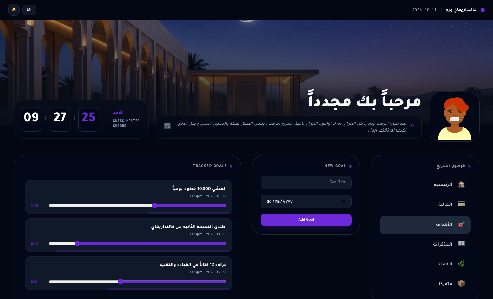
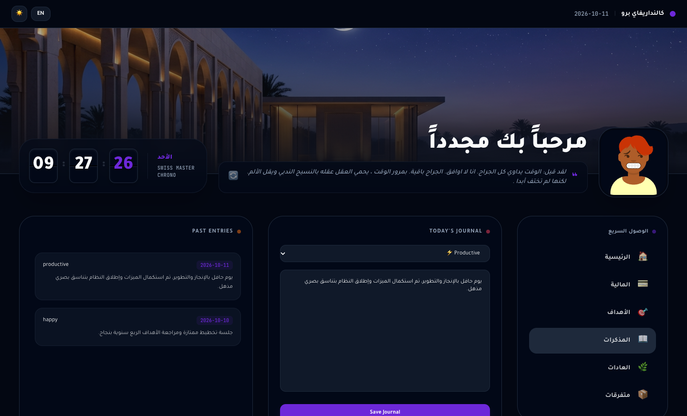
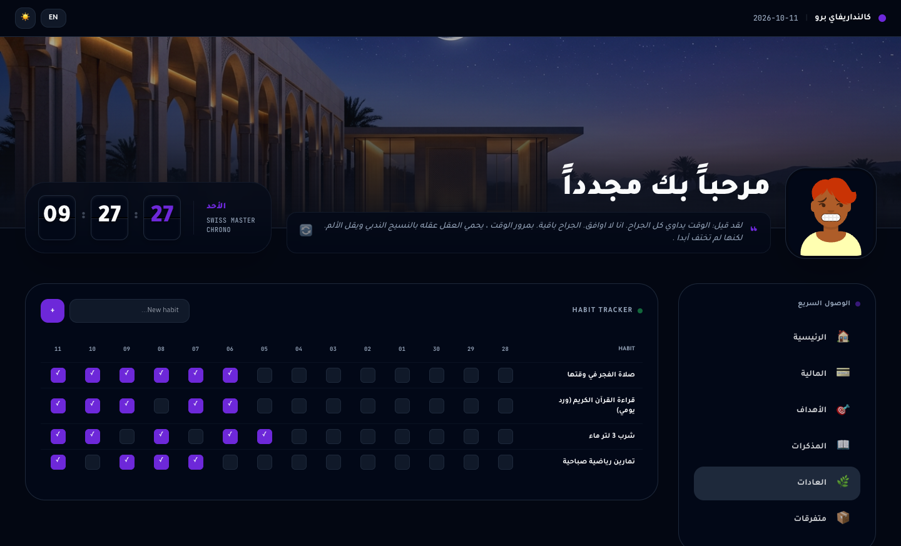
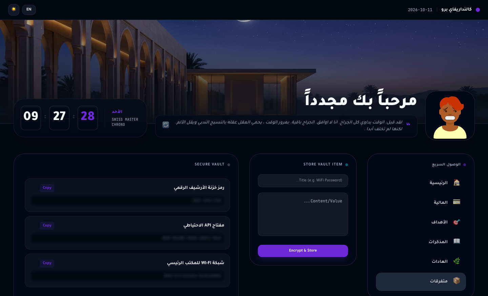

# Calendarify Pro - Modern Hijri & Productivity Suite

<div align="center">



**An ultra-modern, zero-dependency personal dashboard featuring dual Gregorian & Umm al-Qura Hijri calendar sync, Swiss flip clock, productivity modules, and local SQLite persistence.**

[](https://php.net)
[](https://sqlite.org)
[](https://alpinejs.dev)
[](https://tailwindcss.com)
[](https://greensock.com)

</div>

---

## 🌟 Overview & Key Highlights

**Calendarify Pro** combines aesthetic elegance with extreme performance. Built as a unified single-file monolith (`index.php`), it requires zero external build steps or heavy node dependencies, storing everything in a local SQLite database (`calendarify.sqlite`).

* **Dual Calendar Engine**: Instant mathematical synchronization between Gregorian and Umm al-Qura Hijri lunar dates.
* **Precision Swiss Flip Chronometer**: High-contrast flip clock strictly locked in LTR (`[HH] : [MM] : [SS]`) across both Arabic and English layouts.
* **Smart Media Resizer**: Built-in GD pipeline that automatically scales cover banners up to 1920×1080px and center-crops avatars into 1:1 square 400×400px assets.
* **Dynamic Inspirational Quotes**: 500-quote bundled seed (`quotes_seed.json`) with random batch fallbacks from Hugging Face (`AhmedBou/Arabic_Quotes`), per-quote view tracking, and automatic cycle reset on pool depletion.
* **Seamless SPA Routing**: Instant page navigation between 6 dedicated functional views driven by Alpine.js and GSAP fluid transitions.

---

## 📸 Modules & Feature Showcase

### 1. 🏠 Dashboard & Dual Calendar
The primary command center showcasing the flip clock, personalized greeting, draggable interactive cover banner, dual-date matrix, fast task manager, and upcoming birthdays tracker.


* **Dual Dates**: Real-time lunar day display for every calendar day cell.
* **Draggable Header Canvas**: Drag vertically to reposition the cover banner with live coordinate persistence.
* **Bilingual Engine**: Instant RTL/LTR and Arabic/English language toggle with dark/light theme switching.

---

### 2. 💳 Finance Tracker (المالية)
Comprehensive personal cashflow manager with instant balance calculation and color-coded transaction ledger.



* **Transaction Ledger**: Add income (`+$`) and expense (`-$`) transactions with custom categories, dates, and optional notes.
* **Live Net Balance**: Automatically calculates net balance (`financeBalance`) across all historical records.
* **Ledger Management**: Single-click deletion with immediate SQLite synchronization and visual toast alerts.

---

### 3. 🎯 Goals & Milestones (الأهداف)
Visual target tracking dashboard with interactive progress sliders and completion indicators.



* **Interactive Progress Sliders**: Drag from 0% to 100% with real-time database syncing (`update_goal_progress`).
* **Visual Progress Bar**: Fluid animated progress gauge reflecting completion status.
* **Target Dates**: Set milestone deadlines with automatic sorting by target date.

---

### 4. 📖 Daily Journal (المذكرات)
Reflective personal journaling system with mood logging and past entry archive.



* **Mood Logging**: Categorize entries by emotional state: *Happy* 😊, *Neutral* 😐, *Sad* 😔, *Productive* ⚡, or *Tired* 🥱.
* **Automatic Upsert**: Preserves one entry per date with automatic loading of today's existing thoughts.
* **Historical Timeline**: Clean chronologically sorted feed of past daily reflections.

---

### 5. 🌿 Habits Tracker (العادات)
Trailing 14-day habit matrix designed to build consistent daily routines and streaks.



* **14-Day Matrix**: Interactive rolling grid tracking progress over the past two weeks.
* **One-Click Toggles**: Tap any cell to record or remove completion with instant database persistence.
* **Custom Habits**: Add and delete custom habits with real-time UI updates.

---

### 6. 📦 Secure Vault (متفرقات)
Private repository for sensitive snippets, WiFi credentials, keys, and confidential notes.



* **Hover-to-Reveal Blur Protection**: Content is masked behind a `blur(4px)` shield by default to prevent shoulder-surfing.
* **One-Click Copy**: Fast clipboard integration with instant toast confirmation.
* **Quick Management**: Add and purge confidential snippets anytime.

---

## 🛠️ Architecture & Tech Stack

```
calendar-hijri/
├── index.php             # Unified monolithic application (Backend API + Frontend SPA)
├── calendarify.sqlite    # SQLite 3 local database with self-migrating schema
├── quotes_seed.json      # Offline production cache of 500 inspirational Arabic quotes
├── uploads/              # Storage directory for optimized cover banners and avatars
│   ├── header_cover.jpg
│   └── avatar.png
├── docs/
│   └── screenshots/      # High-resolution screenshots of all application views
│       ├── dashboard.png
│       ├── finance.png
│       ├── goals.png
│       ├── journal.png
│       ├── habits.png
│       └── vault.png
└── screenshot.png        # Primary dashboard overview preview
```

### Technology Highlights
- **Backend**: Native PHP 8.1+ with PDO SQLite, zero external extensions required (standard GD for image resizing).
- **Frontend SPA**: Alpine.js 3 for reactive state management, Tailwind CSS for modern dark-mode aesthetic styling.
- **Animations**: GSAP 3 with GSAP Draggable for silky smooth timelines and gestures.
- **Typography**: Inter & Tajawal fonts loaded via Google Fonts.

---

## 🗄️ Database Schema Reference

The database initializes automatically on first run via `index.php`:

| Table | Columns | Purpose |
| :--- | :--- | :--- |
| `settings` | `key (PK), value` | Persists user preferences (theme, language, cover position, image paths). |
| `reminders` | `id (PK), date, content, created_at` | Date-specific reminders and notes attached to calendar days. |
| `tasks` | `id (PK), title, completed, due_time, created_at` | Quick checklist items with completion states. |
| `birthdays` | `id (PK), name, date, created_at` | Annual recurring events and occasions. |
| `quotes` | `id (PK), text UNIQUE, is_displayed` | Quote cache with cycle depletion tracking. |
| `transactions` | `id (PK), type, amount, category, date, note` | Personal financial income and expense ledger. |
| `goals` | `id (PK), title, target_date, progress, is_completed` | Tracked goals with 0-100% progress. |
| `journal_entries` | `id (PK), date UNIQUE, mood, content` | Daily reflection journal with mood tracking. |
| `habits` | `id (PK), name` | Registered daily habits. |
| `habit_logs` | `habit_id, date (PK)` | Daily completion records for the 14-day habit matrix. |
| `vault_items` | `id (PK), title, content` | Secure credentials and private snippets with blur masking. |

---

## ⚡ API Endpoints

All actions are processed through `POST /?api={action}` with JSON payloads:

```http
POST /?api=add_transaction      # { type, amount, category, date, note }
POST /?api=delete_transaction   # { id }
POST /?api=add_goal             # { title, target_date }
POST /?api=update_goal_progress # { id, progress }
POST /?api=delete_goal          # { id }
POST /?api=save_journal         # { date, mood, content }
POST /?api=add_habit            # { name }
POST /?api=toggle_habit_log     # { habit_id, date }
POST /?api=delete_habit         # { id }
POST /?api=add_vault_item       # { title, content }
POST /?api=delete_vault_item    # { id }
POST /?api=save_setting         # { key, value }
POST /?api=update_media         # multipart/form-data: { target: 'header_img'|'avatar_img', file|url }
POST /?api=get_quote            # Fetches next undisplayed quote or resets cycle
```

---

## 🚀 Quick Start & Local Execution

### 1. Prerequisites
- **PHP 8.1 or higher** with `pdo_sqlite` and `gd` enabled.

### 2. Run Locally
Serve the application using PHP's built-in web server:

```bash
php -S localhost:8011 -t ./
```

### 3. Open in Browser
Visit [http://localhost:8011](http://localhost:8011) in your browser.

---

## 📄 License
Open-source under the MIT License.
